Nuxt 提供了一些实用工具，可无缝处理 [Nuxt modules](/modules)。

## `nuxt module add`

<!--module-add-cmd-->
```bash [Terminal]
npx nuxt module add <MODULENAME...> [--cwd=<directory>] [--logLevel=<silent|info|verbose>] [--skipInstall] [--skipConfig] [--dev] [--packageManager=<npm|pnpm|yarn|bun|deno|aube|nub|upm>]
```
<!--/module-add-cmd-->

### 参数

<!--module-add-args-->
| 参数            | 描述                                               |
|-----------------|----------------------------------------------------|
| `MODULENAME...` | 指定要按名称安装的一个或多个模块，以空格分隔       |
<!--/module-add-args-->

### 选项

<!--module-add-opts-->
| 选项                                                       | 默认值 | 描述                                     |
|------------------------------------------------------------|---------|------------------------------------------|
| `--cwd=<directory>`                                        | `.`     | 指定 Nuxt 项目的根目录                   |
| `--logLevel=<silent\|info\|verbose>`                       |         | 指定构建时日志级别                       |
| `--skipInstall`                                            |         | 跳过 npm 安装                            |
| `--skipConfig`                                             |         | 跳过 nuxt.config.ts 更新                  |
| `--dev`                                                    |         | 将模块作为开发依赖安装                   |
| `--packageManager=<npm\|pnpm\|yarn\|bun\|deno\|aube\|nub\|upm>` |         | 用于安装的软件包管理器                   |
<!--/module-add-opts-->

该命令可让你无需手动操作即可在应用中安装 [Nuxt modules](/modules)。

运行命令时，它将：

- 使用你的软件包管理器将模块安装为依赖项
- 将其添加到你的 [package.json](/docs/directory-structure/package) 文件中
- 更新你的 [`nuxt.config`](/docs/directory-structure/nuxt-config) 文件

**示例：**

安装 [`Pinia`](/modules/pinia) 模块

```bash [Terminal]
npx nuxt module add pinia
```

不指定模块名称运行该命令，即可从与你的 Nuxt 版本兼容的模块中进行选择。

::note
[`nuxt add`](/docs/api/commands/add) 是相同的命令，同时也接受层。
::

## `nuxt module remove`

<!--module-remove-cmd-->
```bash [Terminal]
npx nuxt module remove [MODULENAME...] [--cwd=<directory>] [--logLevel=<silent|info|verbose>] [--skipInstall] [--skipConfig]
```
<!--/module-remove-cmd-->

### 参数

<!--module-remove-args-->
| 参数            | 描述                                               |
|-----------------|----------------------------------------------------|
| `MODULENAME...` | 指定要按名称移除的一个或多个模块，以空格分隔       |
<!--/module-remove-args-->

### 选项

<!--module-remove-opts-->
| 选项                               | 默认值 | 描述                                     |
|--------------------------------------|---------|------------------------------------------|
| `--cwd=<directory>`                  | `.`     | 指定 Nuxt 项目的根目录                   |
| `--logLevel=<silent\|info\|verbose>` |         | 指定构建时日志级别                       |
| `--skipInstall`                      |         | 跳过依赖卸载                             |
| `--skipConfig`                       |         | 跳过 nuxt.config.ts 更新                  |
<!--/module-remove-opts-->

该命令会卸载软件包，并将其从你的 [`nuxt.config`](/docs/directory-structure/nuxt-config) 中的 `modules` 数组移除。

**示例：**

```bash [Terminal]
npx nuxt module remove pinia
```

不指定模块名称运行该命令，即可从项目当前使用的模块中进行选择。

## `nuxt module search`

<!--module-search-cmd-->
```bash [Terminal]
npx nuxt module search <QUERY> [--cwd=<directory>] [--nuxtVersion=<3|4|4.2.0>] [--json]
```
<!--/module-search-cmd-->



### 参数

<!--module-search-args-->
| 参数    | 描述             |
|---------|------------------|
| `QUERY` | 要搜索的关键词   |
<!--/module-search-args-->

### 选项

<!--module-search-opts-->
| 选项                         | 默认值 | 描述                                                                               |
|------------------------------|---------|------------------------------------------------------------------------------------|
| `--cwd=<directory>`          | `.`     | 指定 Nuxt 项目的根目录                                                             |
| `--nuxtVersion=<3\|4\|4.2.0>` |         | 按 Nuxt 版本筛选，仅列出兼容的模块（默认自动检测）                                |
| `--json`                     |         | 以 JSON 格式输出结果                                                               |
<!--/module-search-opts-->

该命令会搜索与你的查询匹配且兼容你的 Nuxt 版本的 Nuxt modules，并显示每个模块的描述，同时突出显示匹配的文本。

**示例：**

```bash [Terminal]
npx nuxt module search pinia
```

使用 `--json` 可获取机器可读的 JSON 格式结果。

## `nuxt module build`

<!--module-build-cmd-->
```bash [Terminal]
npx nuxt module build [ROOTDIR] [--cwd=<directory>] [--outDir=<directory>] [--sourcemap]
```
<!--/module-build-cmd-->

### 参数

<!--module-build-args-->
| 参数      | 描述                           |
|-----------|--------------------------------|
| `ROOTDIR` | Nuxt 模块的根目录（默认值：.） |
<!--/module-build-args-->

### 选项

<!--module-build-opts-->
| 选项                   | 默认值 | 描述                                  |
|------------------------|--------|---------------------------------------|
| `--cwd=<directory>`    |        | 指定 Nuxt 模块的根目录                |
| `--outDir=<directory>` |        | 相对于模块根目录的输出目录（默认值：`dist`） |
| `--sourcemap`          |        | 生成 source map                       |
<!--/module-build-opts-->

此命令会将所有参数传递给 `@nuxt/module-builder` 中的 `nuxt-module-build build`，以构建用于发布的模块。你的模块中必须安装 `@nuxt/module-builder`。

**示例：**

```bash [Terminal]
npx nuxt module build
```

::read-more{to="https://github.com/nuxt/module-builder/blob/main/docs/2.commands.md#build" icon="i-simple-icons-github" target="\_blank"}
详细了解 `nuxt-module-build build`。
::

## `nuxt module prepare`

<!--module-prepare-cmd-->
```bash [Terminal]
npx nuxt module prepare [ROOTDIR] [--cwd=<directory>]
```
<!--/module-prepare-cmd-->

### 参数

<!--module-prepare-args-->
| 参数      | 描述                           |
|-----------|--------------------------------|
| `ROOTDIR` | Nuxt 模块的根目录（默认值：.） |
<!--/module-prepare-args-->

### 选项

<!--module-prepare-opts-->
| 选项                 | 默认值 | 描述                    |
|----------------------|--------|-------------------------|
| `--cwd=<directory>`  |        | 指定 Nuxt 模块的根目录  |
<!--/module-prepare-opts-->

此命令会将所有参数传递给 `@nuxt/module-builder` 中的 `nuxt-module-build prepare`，为模块创建 `.nuxt` 目录并生成类型。

**示例：**

```bash [Terminal]
npx nuxt module prepare
```

::read-more{to="https://github.com/nuxt/module-builder/blob/main/docs/2.commands.md#prepare" icon="i-simple-icons-github" target="\_blank"}
详细了解 `nuxt-module-build prepare`。
::
